# reactSwissComponents component catalogue

Source: https://github.com/detonnate/reactSwissComponents  
58 components, 148 screenshots.

## Contents

- **charts**: [BarChart](#barchart), [Gauge](#gauge), [LineChart](#linechart), [PieChart](#piechart), [ScatterChart](#scatterchart), [Sparkline](#sparkline)
- **containers**: [Accordion](#accordion), [Carousel](#carousel), [Drawer](#drawer), [Dropdown](#dropdown), [Modal](#modal), [Tooltip](#tooltip)
- **feedback**: [Alert](#alert), [Badge](#badge), [BadgeAnchor](#badgeanchor), [Progress](#progress), [Skeleton](#skeleton), [Spinner](#spinner), [Steps](#steps), [Tag](#tag), [ToastProvider](#toastprovider)
- **forms**: [Button](#button), [Checkbox](#checkbox), [ComboBox](#combobox), [DatePicker](#datepicker), [Field](#field), [FileUploader](#fileuploader), [Input](#input), [Radio](#radio), [RadioGroup](#radiogroup), [SearchBar](#searchbar), [Select](#select), [Slider](#slider), [Stepper](#stepper), [Switch](#switch), [Textarea](#textarea)
- **layout**: [Box](#box), [Card](#card), [Container](#container), [Grid](#grid), [GridItem](#griditem), [Heading](#heading), [Stack](#stack), [Text](#text)
- **navigation**: [Breadcrumbs](#breadcrumbs), [Footer](#footer), [Navbar](#navbar), [Pagination](#pagination), [Sidebar](#sidebar), [Tabs](#tabs)
- **sections**: [Avatar](#avatar), [Feed](#feed), [FormContainer](#formcontainer), [Hero](#hero), [LogoStrip](#logostrip), [Testimonial](#testimonial), [VideoPlayer](#videoplayer)
- **table**: [DataTable](#datatable)

## charts

### BarChart

`src/components/charts.tsx`

Props: `series*`, `labels*`, `stacked`, `title`

**Default**

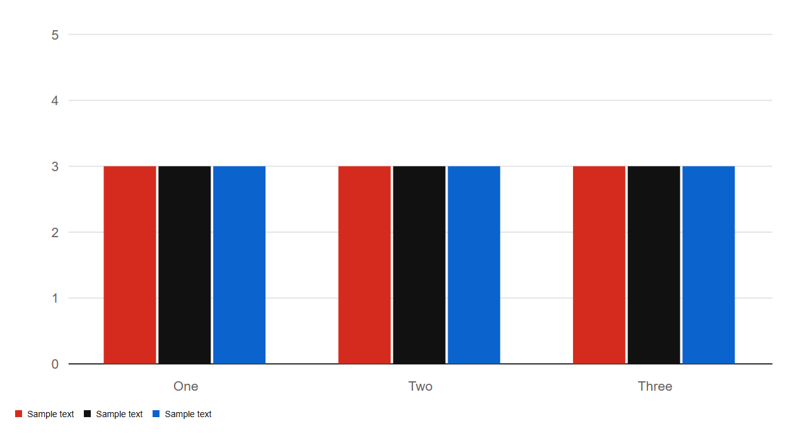

**stacked**

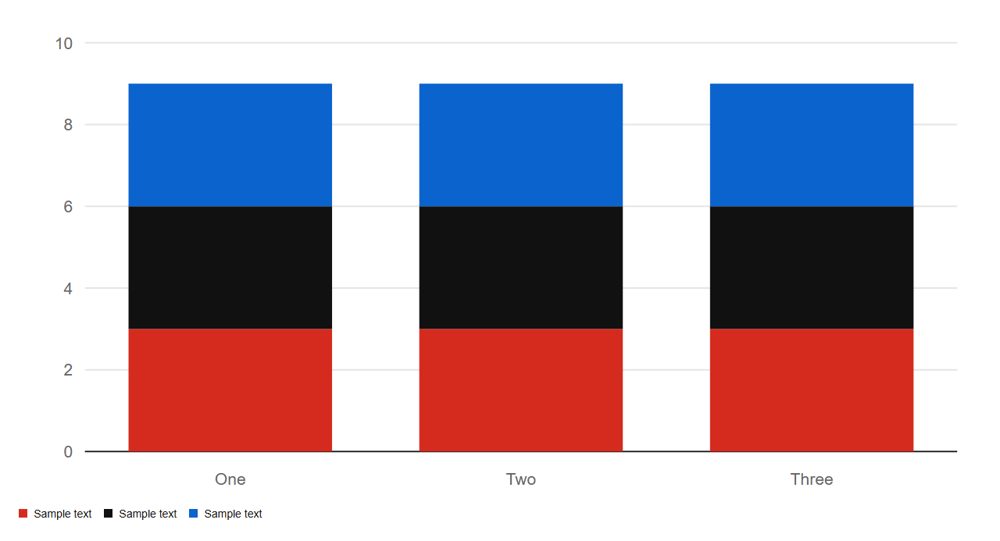

[Full docs](components/BarChart.md)

### Gauge

`src/components/charts.tsx`

Props: `value*`, `max`, `label`

**Default**

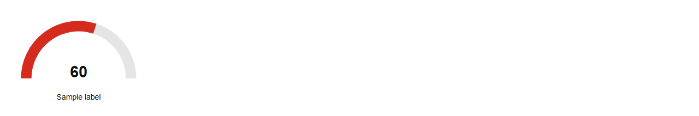

[Full docs](components/Gauge.md)

### LineChart

`src/components/charts.tsx`

Props: `series*`, `labels*`, `area`, `title`

**Default**

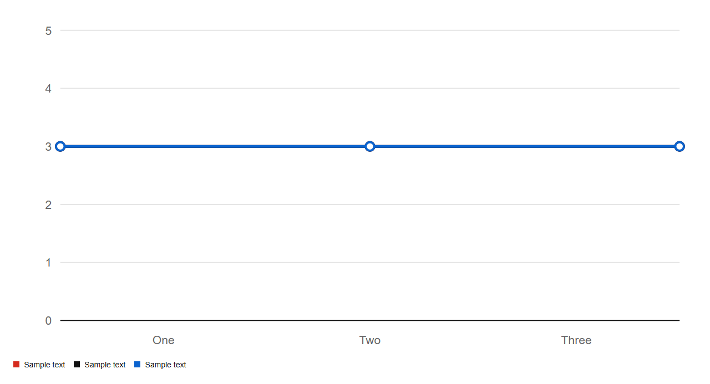

**area**

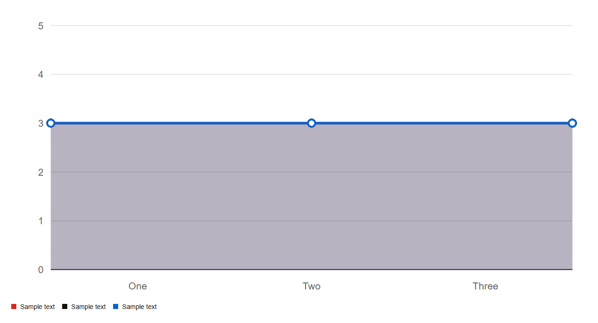

[Full docs](components/LineChart.md)

### PieChart

`src/components/charts.tsx`

Props: `data*`, `donut`, `title`, `centerLabel`

**Default**

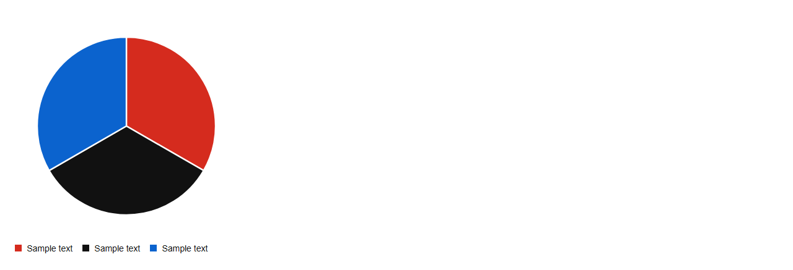

**donut**

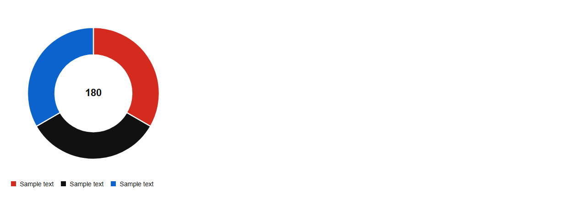

[Full docs](components/PieChart.md)

### ScatterChart

`src/components/charts.tsx`

Props: `series*`, `title`

**Default**

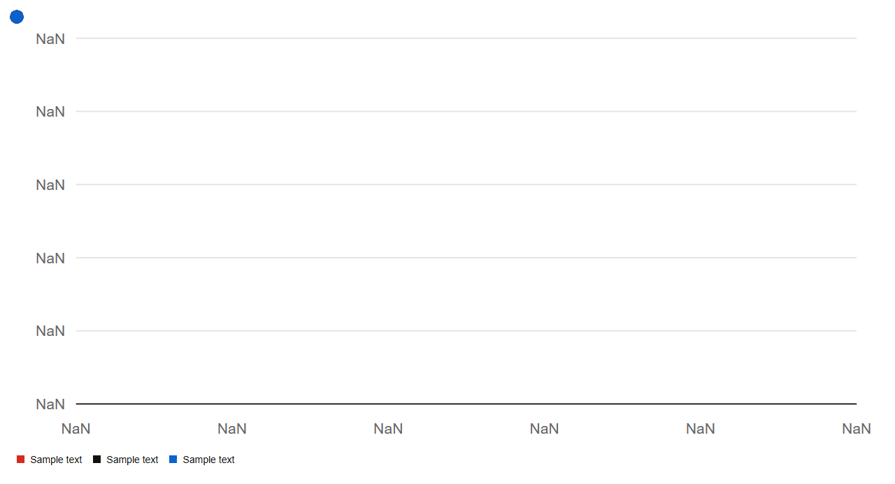

[Full docs](components/ScatterChart.md)

### Sparkline

`src/components/charts.tsx`

Props: `data*`, `color`, `width`, `height`

**Default**

[Full docs](components/Sparkline.md)

## containers

### Accordion

`src/components/containers.tsx`

Props: `items*`, `multiple`, `defaultOpen`

**Default**

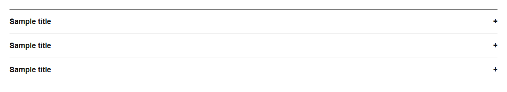

**multiple**

[Full docs](components/Accordion.md)

### Carousel

`src/components/containers.tsx`

Props: `slides*`, `autoPlayMs`, `label`

**Default**

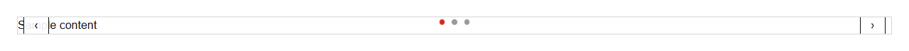

[Full docs](components/Carousel.md)

### Drawer

`src/components/containers.tsx`

Props: `isOpen*`, `onClose*`, `title*`, `side`, `children*`

**Default**

**isOpen**

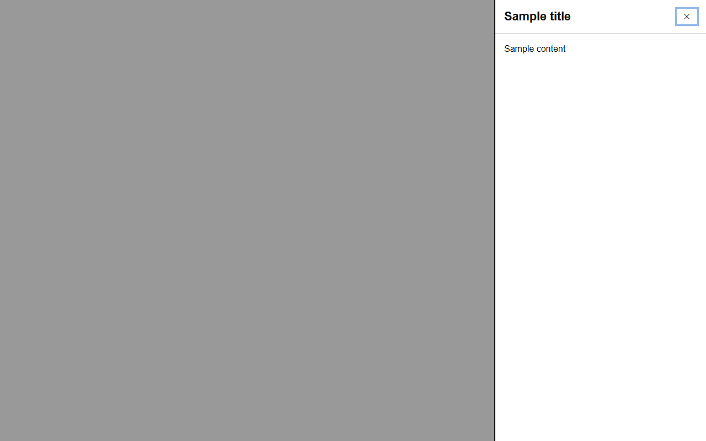

**side: left**

**side: right**

[Full docs](components/Drawer.md)

### Dropdown

`src/components/containers.tsx`

Props: `label*`, `entries*`, `onOpenChange`

**Default**

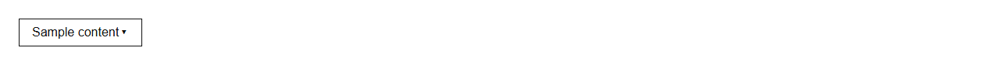

[Full docs](components/Dropdown.md)

### Modal

`src/components/containers.tsx`

Props: `isOpen*`, `onClose*`, `title*`, `children*`, `footer`

**Default**

**isOpen**

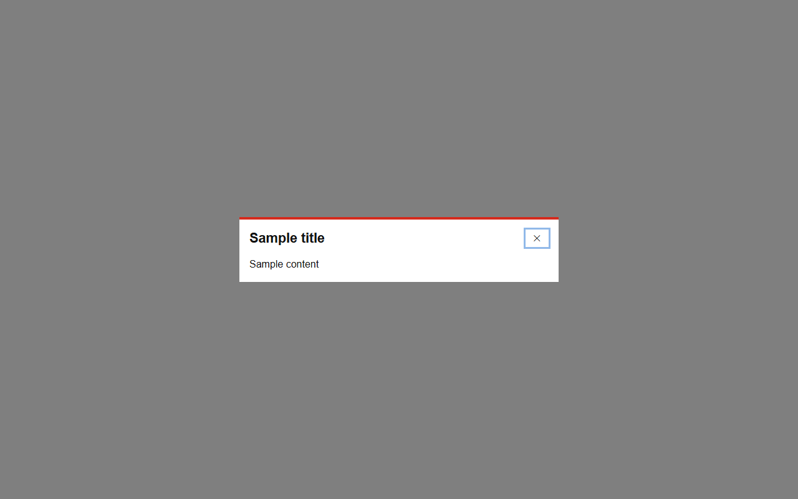

[Full docs](components/Modal.md)

### Tooltip

`src/components/containers.tsx`

Props: `content*`, `children*`, `delay`

**Default**

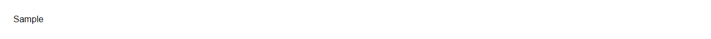

[Full docs](components/Tooltip.md)

## feedback

### Alert

`src/components/feedback.tsx`

Props: `variant`, `title`, `description`, `actions`

**Default**

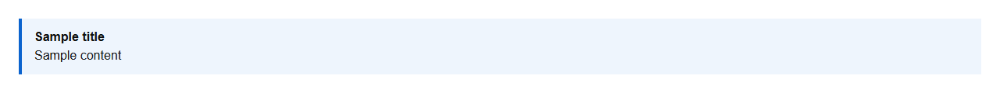

**variant: success**

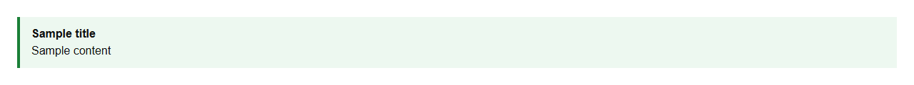

**variant: warning**

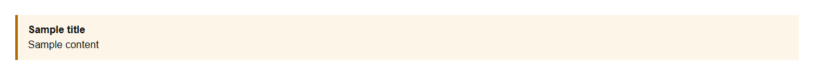

**variant: info**

**variant: error**

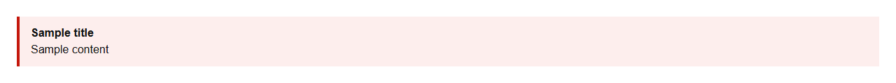

[Full docs](components/Alert.md)

### Badge

`src/components/feedback.tsx`

Props: `children`, `dot`

**Default**

**dot**

[Full docs](components/Badge.md)

### BadgeAnchor

`src/components/feedback.tsx` - Wraps an element with a notification badge (count or dot).

Props: `children`, `dot`, `count`

**Default**

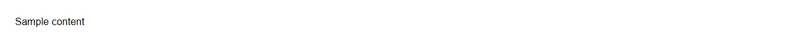

**dot**

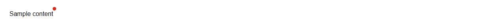

[Full docs](components/BadgeAnchor.md)

### Progress

`src/components/feedback.tsx`

Props: `value*`, `max`, `label`

**Default**

[Full docs](components/Progress.md)

### Skeleton

`src/components/feedback.tsx`

Props: `width`, `height`, `circle`, `lines`

**Default**

**circle**

[Full docs](components/Skeleton.md)

### Spinner

`src/components/feedback.tsx`

Props: `size`, `label`

**Default**

**size: sm**

**size: md**

**size: lg**

[Full docs](components/Spinner.md)

### Steps

`src/components/feedback.tsx`

Props: `steps*`, `current*`

**Default**

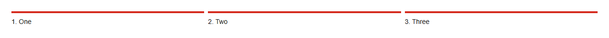

[Full docs](components/Steps.md)

### Tag

`src/components/feedback.tsx`

Props: `children*`, `selected`, `onClick`, `onRemove`

**Default**

**selected**

[Full docs](components/Tag.md)

### ToastProvider

`src/components/feedback.tsx`

Props: `children*`, `durationMs`

**Default**

[Full docs](components/ToastProvider.md)

## forms

### Button

`src/components/forms.tsx`

Props: `children`, `as`, `href`, `variant`, `size`, `loading`, `leftIcon`, `rightIcon`

**Default**

**variant: solid**

**variant: outline**

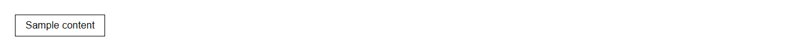

**variant: ghost**

**variant: dark**

**size: sm**

**size: md**

**size: lg**

**loading**

[Full docs](components/Button.md)

### Checkbox

`src/components/forms.tsx`

Props: `label`, `indeterminate`

**Default**

**indeterminate**

[Full docs](components/Checkbox.md)

### ComboBox

`src/components/forms.tsx`

Props: `options*`, `value`, `onChange`, `placeholder`, `searchable`, `size`

**Default**

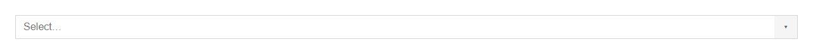

**searchable**

**size: sm**

**size: md**

**size: lg**

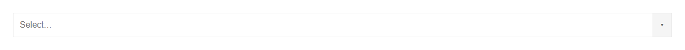

[Full docs](components/ComboBox.md)

### DatePicker

`src/components/forms.tsx`

Props: `value`, `endValue`, `onChange`, `range`, `min`, `max`, `placeholder`

**Default**

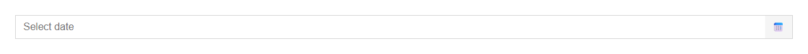

**range**

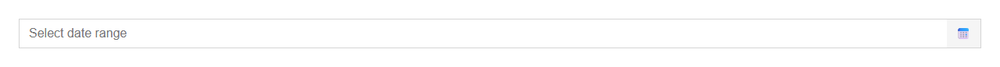

[Full docs](components/DatePicker.md)

### Field

`src/components/forms.tsx`

Props: `label`, `hint`, `error`, `htmlFor`, `children*`

**Default**

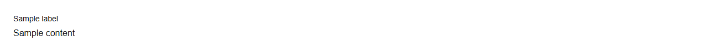

[Full docs](components/Field.md)

### FileUploader

`src/components/forms.tsx`

Props: `accept`, `multiple`, `onFiles`, `label`, `initialFiles`

**Default**

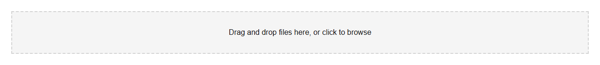

**multiple**

[Full docs](components/FileUploader.md)

### Input

`src/components/forms.tsx`

Props: `size`, `invalid`, `leftAddon`, `rightAddon`, `describedBy`

**Default**

**size: sm**

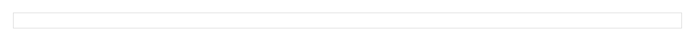

**size: md**

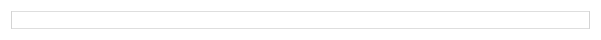

**size: lg**

**invalid**

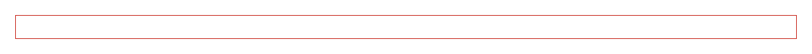

[Full docs](components/Input.md)

### Radio

`src/components/forms.tsx`

Props: `value*`, `label`

**Default**

[Full docs](components/Radio.md)

### RadioGroup

`src/components/forms.tsx`

Props: `name`, `value`, `defaultValue`, `onChange`, `orientation`, `legend`, `children*`

**Default**

**orientation: vertical**

**orientation: horizontal**

[Full docs](components/RadioGroup.md)

### SearchBar

`src/components/forms.tsx`

Props: `value`, `onSearch`, `placeholder`, `size`

**Default**

**size: sm**

**size: md**

**size: lg**

[Full docs](components/SearchBar.md)

### Select

`src/components/forms.tsx`

Props: `size`, `invalid`, `placeholder`, `options*`

**Default**

**size: sm**

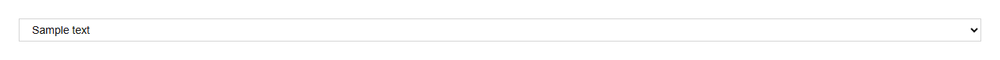

**size: md**

**size: lg**

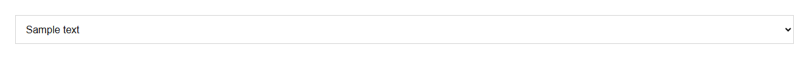

**invalid**

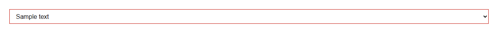

[Full docs](components/Select.md)

### Slider

`src/components/forms.tsx`

Props: `min`, `max`, `step`, `value`, `defaultValue`, `onChange`, `label`, `format`

**Default**

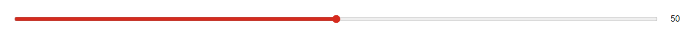

[Full docs](components/Slider.md)

### Stepper

`src/components/forms.tsx`

Props: `value`, `defaultValue`, `min`, `max`, `step`, `onChange`

**Default**

[Full docs](components/Stepper.md)

### Switch

`src/components/forms.tsx`

Props: `checked`, `defaultChecked`, `onChange`, `label`, `disabled`

**Default**

**checked**

**defaultChecked**

**disabled**

[Full docs](components/Switch.md)

### Textarea

`src/components/forms.tsx`

Props: `invalid`, `autoResize`, `describedBy`

**Default**

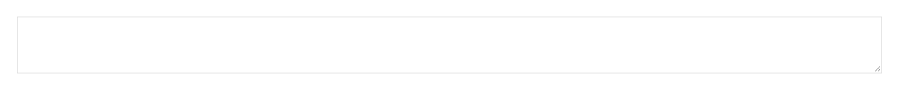

**invalid**

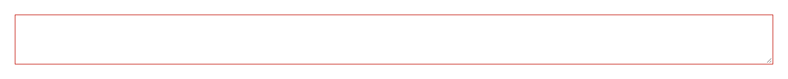

**autoResize**

[Full docs](components/Textarea.md)

## layout

### Box

`src/components/layout.tsx`

Props: `as`

**Default**

[Full docs](components/Box.md)

### Card

`src/components/layout.tsx`

Props: `children`, `actions`

**Default**

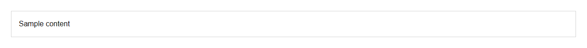

[Full docs](components/Card.md)

### Container

`src/components/layout.tsx`

Props: `size`

**Default**

**size: sm**

**size: md**

**size: lg**

**size: xl**

**size: full**

[Full docs](components/Container.md)

### Grid

`src/components/layout.tsx`

Props: `cols`, `gap`, `align`

**Default**

[Full docs](components/Grid.md)

### GridItem

`src/components/layout.tsx`

Props: `colSpan`, `rowSpan`

**Default**

[Full docs](components/GridItem.md)

### Heading

`src/components/layout.tsx`

Props: `as`, `level`, `size`, `weight`, `align`

**Default**

**size: sm**

**size: md**

**size: lg**

**size: xs**

**size: xl**

**size: 2xl**

**size: 3xl**

**weight: regular**

**weight: medium**

**weight: bold**

**align: left**

**align: right**

**align: center**

[Full docs](components/Heading.md)

### Stack

`src/components/layout.tsx`

Props: `gap`, `direction`, `align`, `justify`, `wrap`

**Default**

**direction: column**

**direction: row**

**wrap**

[Full docs](components/Stack.md)

### Text

`src/components/layout.tsx`

Props: `as`, `size`, `weight`, `align`, `truncate`, `muted`

**Default**

**size: sm**

**size: md**

**size: lg**

**size: xs**

**size: xl**

**weight: regular**

**weight: medium**

**weight: bold**

**align: left**

**align: right**

**align: center**

**truncate**

**muted**

[Full docs](components/Text.md)

## navigation

### Breadcrumbs

`src/components/navigation.tsx`

Props: `items*`

**Default**

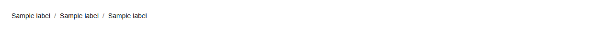

[Full docs](components/Breadcrumbs.md)

### Footer

`src/components/navigation.tsx`

Props: `columns*`, `legal*`

**Default**

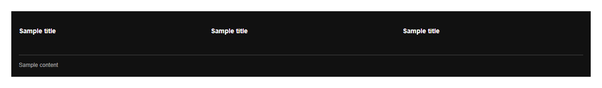

[Full docs](components/Footer.md)

### Navbar

`src/components/navigation.tsx`

Props: `brand*`, `links*`, `actions`, `mega`

**Default**

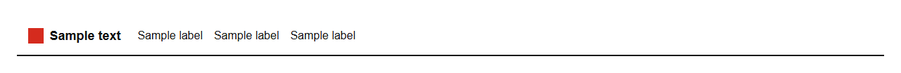

[Full docs](components/Navbar.md)

### Pagination

`src/components/navigation.tsx`

Props: `page*`, `pageCount*`, `onChange*`, `siblings`

**Default**

[Full docs](components/Pagination.md)

### Sidebar

`src/components/navigation.tsx`

Props: `sections*`, `footer`

**Default**

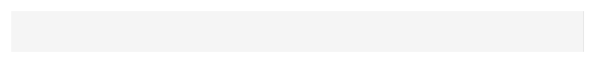

[Full docs](components/Sidebar.md)

### Tabs

`src/components/navigation.tsx`

Props: `items*`, `value`, `defaultValue`, `onChange`, `orientation`

**Default**

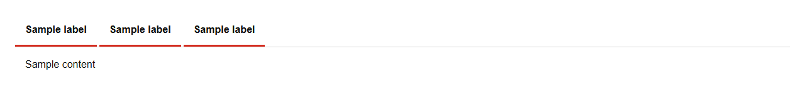

**orientation: vertical**

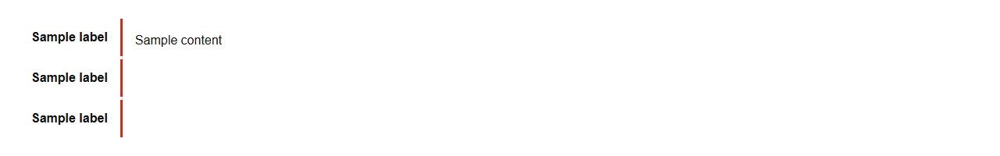

**orientation: horizontal**

[Full docs](components/Tabs.md)

## sections

### Avatar

`src/components/sections.tsx`

Props: `name*`

**Default**

[Full docs](components/Avatar.md)

### Feed

`src/components/sections.tsx`

Props: `items*`

**Default**

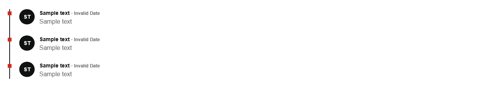

[Full docs](components/Feed.md)

### FormContainer

`src/components/sections.tsx`

Props: `title*`, `description`, `submitLabel`, `onSubmit`, `children*`

**Default**

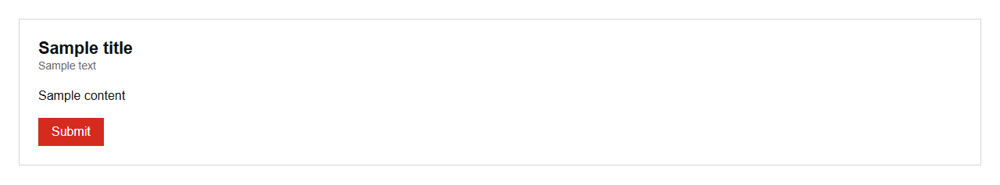

[Full docs](components/FormContainer.md)

### Hero

`src/components/sections.tsx`

Props: `eyebrow`, `title*`, `subtitle*`, `primary*`, `secondary`, `visual`

**Default**

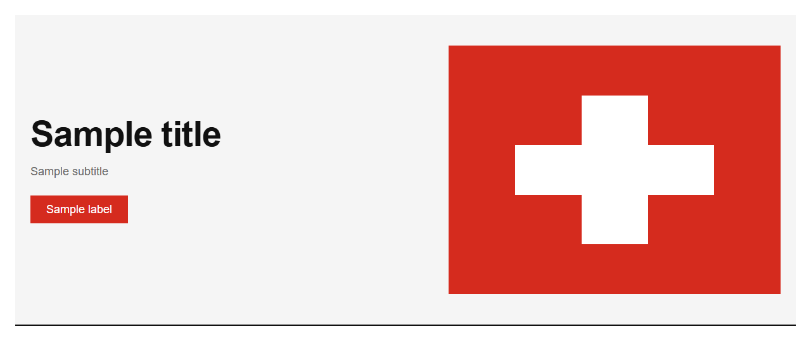

[Full docs](components/Hero.md)

### LogoStrip

`src/components/sections.tsx`

Props: `names*`

**Default**

[Full docs](components/LogoStrip.md)

### Testimonial

`src/components/sections.tsx`

Props: `quote*`, `author*`, `role*`

**Default**

[Full docs](components/Testimonial.md)

### VideoPlayer

`src/components/sections.tsx`

Props: `src`, `poster`, `title`

**Default**

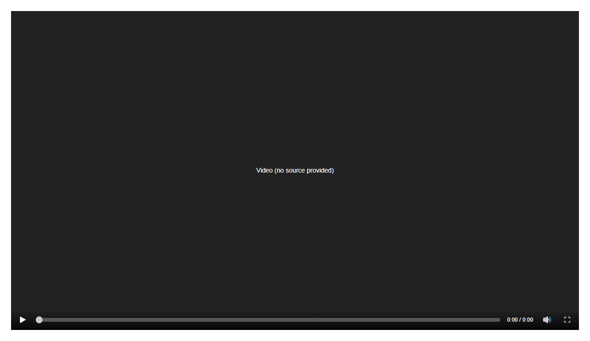

[Full docs](components/VideoPlayer.md)

## table

### DataTable

`src/components/table.tsx`

Props: `columns*`, `rows*`, `rowKey*`, `pageSize`, `searchable`, `selectable`, `striped`, `caption`

**Default**

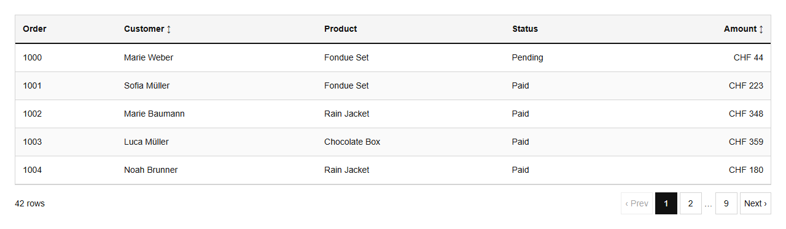

**searchable**

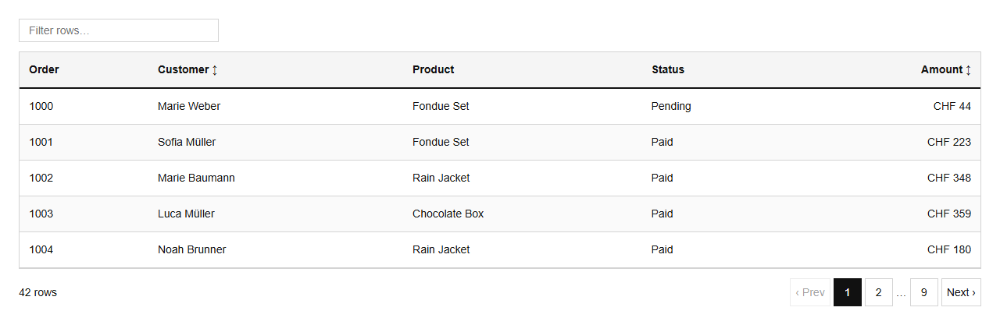

**selectable**

[Full docs](components/DataTable.md)
