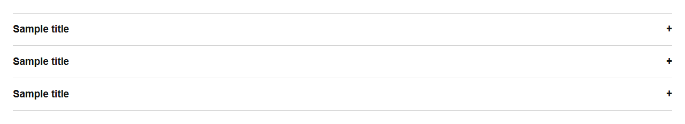

# Accordion


Source: `src/components/containers.tsx`

## Variants

### Default



```tsx
<Accordion items={[{"id":"sample","title":"Sample title","content":"Sample content"},{"id":"sample","title":"Sample title","content":"Sample content"},{"id":"sample","title":"Sample title","content":"Sample content"}]} />
```

### multiple


```tsx
<Accordion items={[{"id":"sample","title":"Sample title","content":"Sample content"},{"id":"sample","title":"Sample title","content":"Sample content"},{"id":"sample","title":"Sample title","content":"Sample content"}]} multiple />
```

## Props

| Name | Type | Required | Default | Description |
|---|---|---|---|---|
| `items` | `{ id: string; title: string; content: React.ReactNode; }[]` | yes |  |  |
| `multiple` | `boolean \| undefined` |  | false |  |
| `defaultOpen` | `string[] \| undefined` |  | [] |  |
