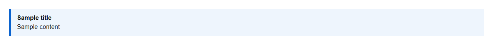
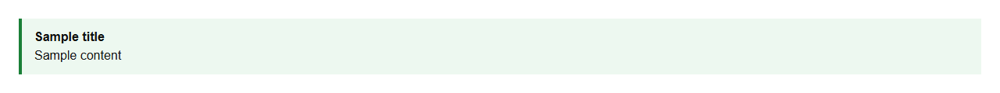
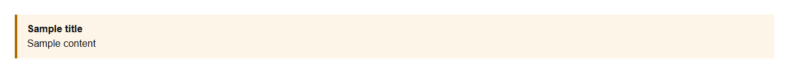
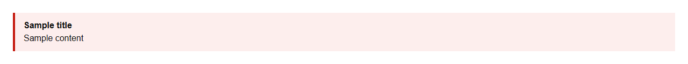

# Alert


Source: `src/components/feedback.tsx`

## Variants

### Default



```tsx
<Alert title="Sample title" description="Sample content" />
```

### variant: success



```tsx
<Alert title="Sample title" description="Sample content" variant="success" />
```

### variant: warning



```tsx
<Alert title="Sample title" description="Sample content" variant="warning" />
```

### variant: info


```tsx
<Alert title="Sample title" description="Sample content" variant="info" />
```

### variant: error



```tsx
<Alert title="Sample title" description="Sample content" variant="error" />
```

## Props

| Name | Type | Required | Default | Description |
|---|---|---|---|---|
| `variant` | `"success" \| "warning" \| "info" \| "error" \| undefined` |  | 'info' |  |
| `title` | `string \| undefined` |  |  |  |
| `description` | `React.ReactNode` |  |  |  |
| `actions` | `React.ReactNode` |  |  |  |
