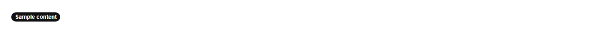

# Badge


Source: `src/components/feedback.tsx`

## Variants

### Default



```tsx
<Badge>Sample content</Badge>
```

### dot


```tsx
<Badge dot>Sample content</Badge>
```

## Props

| Name | Type | Required | Default | Description |
|---|---|---|---|---|
| `children` | `React.ReactNode` |  |  |  |
| `dot` | `boolean \| undefined` |  |  |  |
