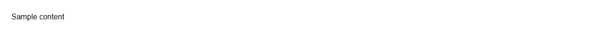
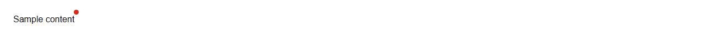

# BadgeAnchor

Wraps an element with a notification badge (count or dot).
Source: `src/components/feedback.tsx`

## Variants

### Default



```tsx
<BadgeAnchor>Sample content</BadgeAnchor>
```

### dot



```tsx
<BadgeAnchor dot>Sample content</BadgeAnchor>
```

## Props

| Name | Type | Required | Default | Description |
|---|---|---|---|---|
| `children` | `React.ReactNode` |  |  |  |
| `dot` | `boolean \| undefined` |  |  |  |
| `count` | `number \| undefined` |  |  |  |
