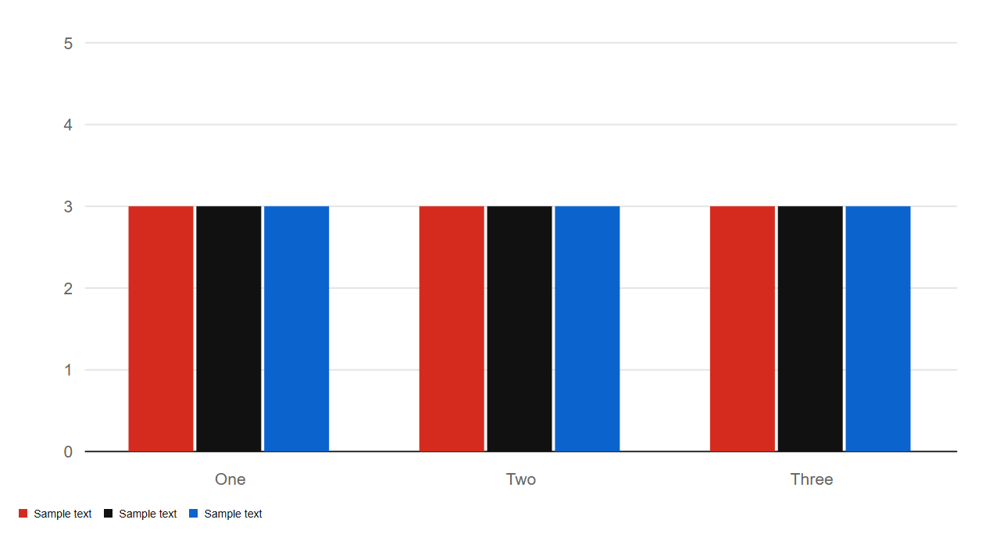
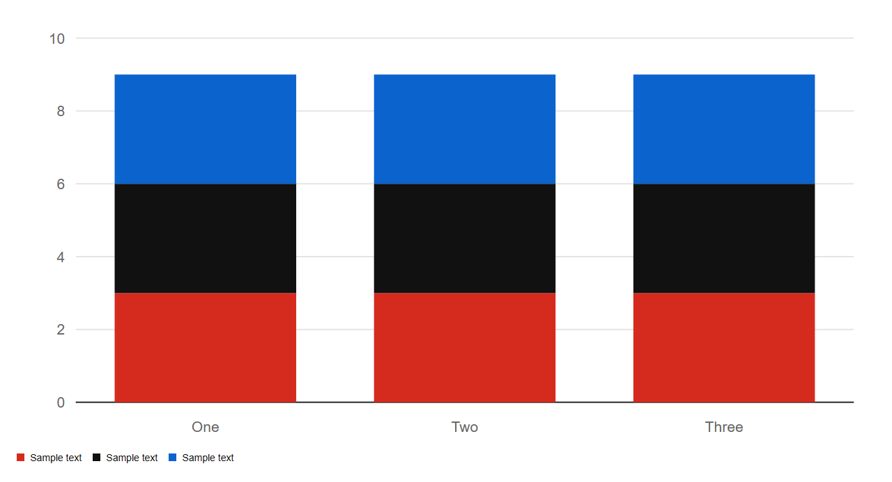

# BarChart


Source: `src/components/charts.tsx`

## Variants

### Default



```tsx
<BarChart series={[{"name":"Sample text","data":[3,3,3]},{"name":"Sample text","data":[3,3,3]},{"name":"Sample text","data":[3,3,3]}]} labels={["One","Two","Three"]} />
```

### stacked



```tsx
<BarChart series={[{"name":"Sample text","data":[3,3,3]},{"name":"Sample text","data":[3,3,3]},{"name":"Sample text","data":[3,3,3]}]} labels={["One","Two","Three"]} stacked />
```

## Props

| Name | Type | Required | Default | Description |
|---|---|---|---|---|
| `series` | `Series[]` | yes |  |  |
| `labels` | `string[]` | yes |  |  |
| `stacked` | `boolean \| undefined` |  |  |  |
| `title` | `string \| undefined` |  | 'Bar chart' |  |
