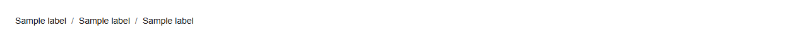

# Breadcrumbs


Source: `src/components/navigation.tsx`

## Variants

### Default



```tsx
<Breadcrumbs items={[{"label":"Sample label"},{"label":"Sample label"},{"label":"Sample label"}]} />
```

## Props

| Name | Type | Required | Default | Description |
|---|---|---|---|---|
| `items` | `{ label: string; href?: string; }[]` | yes |  |  |
