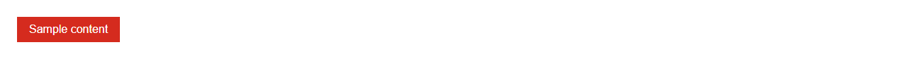
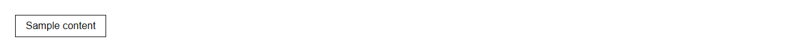
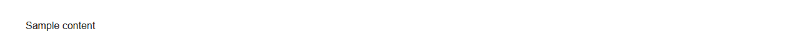
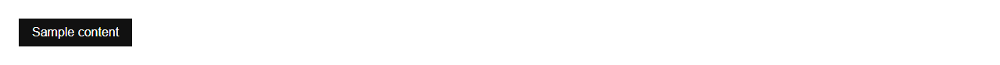
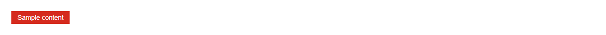
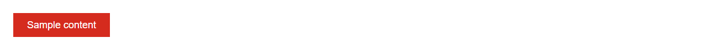
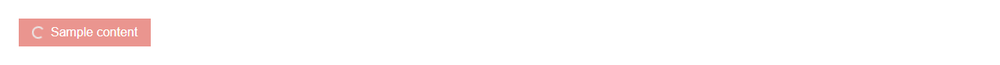

# Button


Source: `src/components/forms.tsx`

## Variants

### Default



```tsx
<Button>Sample content</Button>
```

### variant: solid


```tsx
<Button variant="solid">Sample content</Button>
```

### variant: outline



```tsx
<Button variant="outline">Sample content</Button>
```

### variant: ghost



```tsx
<Button variant="ghost">Sample content</Button>
```

### variant: dark



```tsx
<Button variant="dark">Sample content</Button>
```

### size: sm



```tsx
<Button size="sm">Sample content</Button>
```

### size: md


```tsx
<Button size="md">Sample content</Button>
```

### size: lg



```tsx
<Button size="lg">Sample content</Button>
```

### loading



```tsx
<Button loading>Sample content</Button>
```

## Props

| Name | Type | Required | Default | Description |
|---|---|---|---|---|
| `children` | `React.ReactNode` |  |  |  |
| `as` | `React.ElementType<any, keyof React.JSX.IntrinsicElements> \| undefined` |  | 'button' |  |
| `href` | `string \| undefined` |  |  |  |
| `variant` | `"solid" \| "outline" \| "ghost" \| "dark" \| undefined` |  | 'solid' |  |
| `size` | `Size \| undefined` |  | 'md' |  |
| `loading` | `boolean \| undefined` |  |  |  |
| `leftIcon` | `React.ReactNode` |  |  |  |
| `rightIcon` | `React.ReactNode` |  |  |  |
