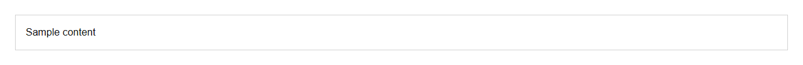

# Card


Source: `src/components/layout.tsx`

## Variants

### Default



```tsx
<Card>Sample content</Card>
```

## Props

| Name | Type | Required | Default | Description |
|---|---|---|---|---|
| `children` | `React.ReactNode` |  |  |  |
| `actions` | `React.ReactNode` |  |  |  |
