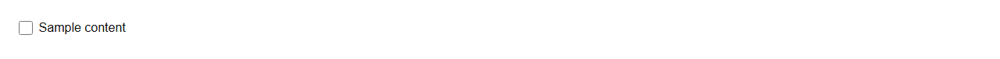
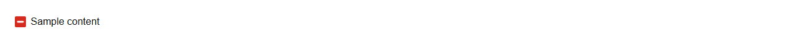

# Checkbox


Source: `src/components/forms.tsx`

## Variants

### Default



```tsx
<Checkbox label="Sample content" />
```

### indeterminate



```tsx
<Checkbox label="Sample content" indeterminate />
```

## Props

| Name | Type | Required | Default | Description |
|---|---|---|---|---|
| `label` | `React.ReactNode` |  |  |  |
| `indeterminate` | `boolean \| undefined` |  |  |  |
