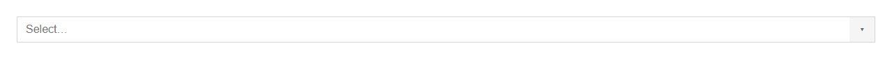
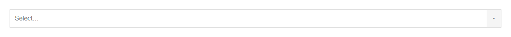

# ComboBox


Source: `src/components/forms.tsx`

## Variants

### Default


```tsx
<ComboBox options={[{"value":"Sample text","label":"Sample label"},{"value":"Sample text","label":"Sample label"},{"value":"Sample text","label":"Sample label"}]} />
```

### searchable


```tsx
<ComboBox options={[{"value":"Sample text","label":"Sample label"},{"value":"Sample text","label":"Sample label"},{"value":"Sample text","label":"Sample label"}]} searchable />
```

### size: sm


```tsx
<ComboBox options={[{"value":"Sample text","label":"Sample label"},{"value":"Sample text","label":"Sample label"},{"value":"Sample text","label":"Sample label"}]} size="sm" />
```

### size: md



```tsx
<ComboBox options={[{"value":"Sample text","label":"Sample label"},{"value":"Sample text","label":"Sample label"},{"value":"Sample text","label":"Sample label"}]} size="md" />
```

### size: lg



```tsx
<ComboBox options={[{"value":"Sample text","label":"Sample label"},{"value":"Sample text","label":"Sample label"},{"value":"Sample text","label":"Sample label"}]} size="lg" />
```

## Props

| Name | Type | Required | Default | Description |
|---|---|---|---|---|
| `options` | `Option[]` | yes |  |  |
| `value` | `string \| undefined` |  |  |  |
| `onChange` | `((v: string) => void) \| undefined` |  |  |  |
| `placeholder` | `string \| undefined` |  | 'Select…' |  |
| `searchable` | `boolean \| undefined` |  | true | false renders a button-style dropdown select instead of an editable combo. |
| `size` | `Size \| undefined` |  | 'md' |  |
