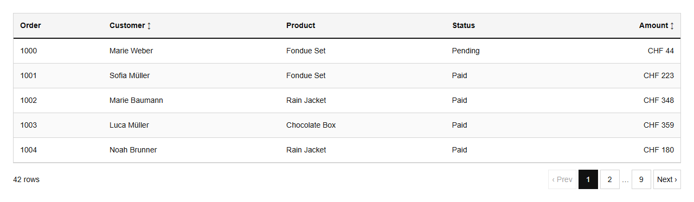
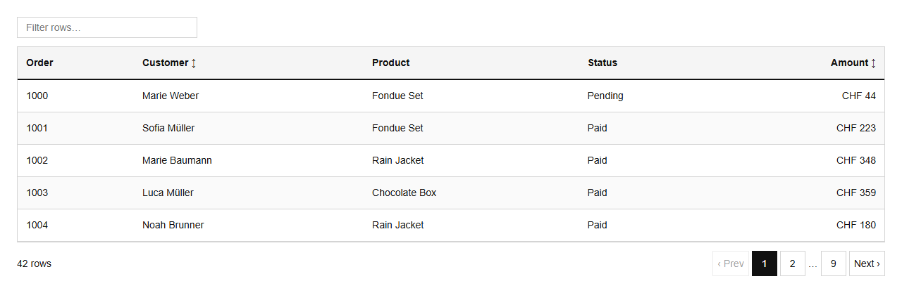
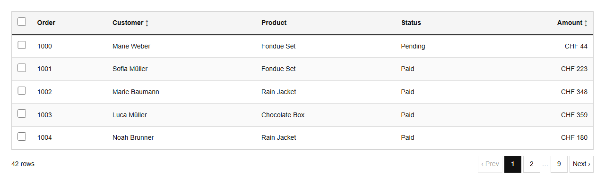

# DataTable


Source: `src/components/table.tsx`

## Variants

### Default



```tsx
<DataTable columns={columns} rows={orders} rowKey={(r) => r.id} pageSize={5} />
```

### searchable



```tsx
<DataTable columns={columns} rows={orders} rowKey={(r) => r.id} searchable />
```

### selectable



```tsx
<DataTable columns={columns} rows={orders} rowKey={(r) => r.id} selectable />
```

## Props

| Name | Type | Required | Default | Description |
|---|---|---|---|---|
| `columns` | `Column<T>[]` | yes |  |  |
| `rows` | `T[]` | yes |  |  |
| `rowKey` | `(row: T) => string \| number` | yes |  |  |
| `pageSize` | `number \| undefined` |  | 8 |  |
| `searchable` | `boolean \| undefined` |  |  |  |
| `selectable` | `boolean \| undefined` |  |  |  |
| `striped` | `boolean \| undefined` |  | true |  |
| `caption` | `string \| undefined` |  |  |  |
