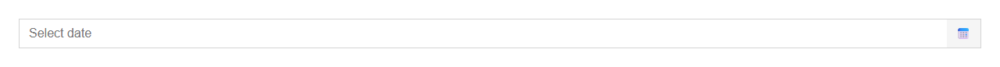
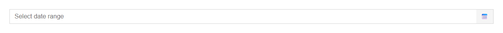

# DatePicker


Source: `src/components/forms.tsx`

## Variants

### Default



```tsx
<DatePicker />
```

### range



```tsx
<DatePicker range />
```

## Props

| Name | Type | Required | Default | Description |
|---|---|---|---|---|
| `value` | `string \| undefined` |  |  | ISO date `YYYY-MM-DD`. In range mode, `value` is the start and `endValue` the end. |
| `endValue` | `string \| undefined` |  |  |  |
| `onChange` | `((start: string, end?: string) => void) \| undefined` |  |  |  |
| `range` | `boolean \| undefined` |  |  |  |
| `min` | `string \| undefined` |  |  |  |
| `max` | `string \| undefined` |  |  |  |
| `placeholder` | `string \| undefined` |  | 'Select date' |  |
