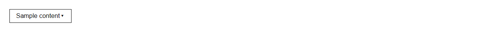

# Dropdown


Source: `src/components/containers.tsx`

## Variants

### Default



```tsx
<Dropdown label="Sample content" entries={[{"label":"Sample label"},{"label":"Sample label"},{"label":"Sample label"}]} />
```

## Props

| Name | Type | Required | Default | Description |
|---|---|---|---|---|
| `label` | `React.ReactNode` | yes |  |  |
| `entries` | `DropdownEntry[]` | yes |  |  |
| `onOpenChange` | `((open: boolean) => void) \| undefined` |  |  |  |
