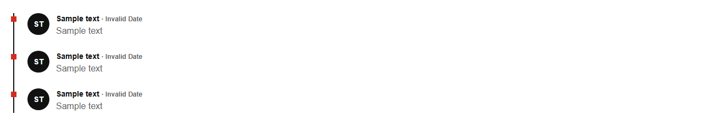

# Feed


Source: `src/components/sections.tsx`

## Variants

### Default



```tsx
<Feed items={[{"id":"sample","author":"Sample text","time":"Sample text","body":"Sample text"},{"id":"sample","author":"Sample text","time":"Sample text","body":"Sample text"},{"id":"sample","author":"Sample text","time":"Sample text","body":"Sample text"}]} />
```

## Props

| Name | Type | Required | Default | Description |
|---|---|---|---|---|
| `items` | `FeedItem[]` | yes |  |  |
