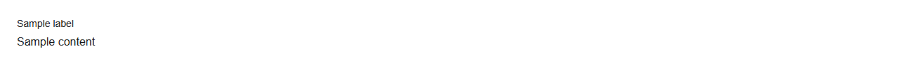

# Field


Source: `src/components/forms.tsx`

## Variants

### Default



```tsx
<Field label="Sample label">Sample content</Field>
```

## Props

| Name | Type | Required | Default | Description |
|---|---|---|---|---|
| `label` | `string \| undefined` |  |  |  |
| `hint` | `string \| undefined` |  |  |  |
| `error` | `string \| undefined` |  |  |  |
| `htmlFor` | `string \| undefined` |  |  |  |
| `children` | `React.ReactNode` | yes |  |  |
