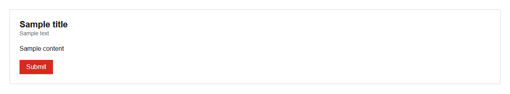

# FormContainer


Source: `src/components/sections.tsx`

## Variants

### Default



```tsx
<FormContainer title="Sample title" description="Sample text">Sample content</FormContainer>
```

## Props

| Name | Type | Required | Default | Description |
|---|---|---|---|---|
| `title` | `string` | yes |  |  |
| `description` | `string \| undefined` |  |  |  |
| `submitLabel` | `string \| undefined` |  | 'Submit' |  |
| `onSubmit` | `((data: FormData) => void) \| undefined` |  |  |  |
| `children` | `React.ReactNode` | yes |  |  |
