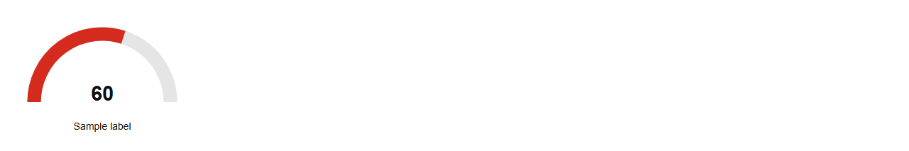

# Gauge


Source: `src/components/charts.tsx`

## Variants

### Default



```tsx
<Gauge value={60} label="Sample label" />
```

## Props

| Name | Type | Required | Default | Description |
|---|---|---|---|---|
| `value` | `number` | yes |  |  |
| `max` | `number \| undefined` |  | 100 |  |
| `label` | `string \| undefined` |  |  |  |
