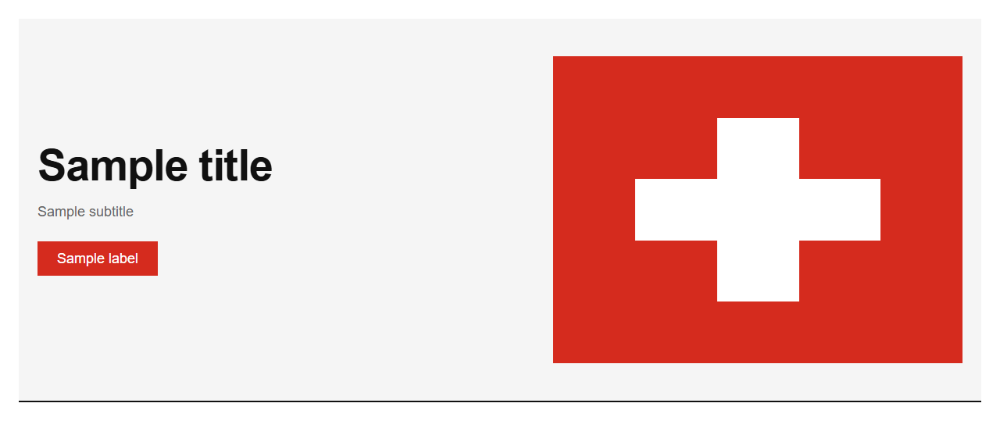

# Hero


Source: `src/components/sections.tsx`

## Variants

### Default



```tsx
<Hero title="Sample title" subtitle="Sample subtitle" primary={{"label":"Sample label"}} />
```

## Props

| Name | Type | Required | Default | Description |
|---|---|---|---|---|
| `eyebrow` | `string \| undefined` |  |  |  |
| `title` | `string` | yes |  |  |
| `subtitle` | `string` | yes |  |  |
| `primary` | `{ label: string; href?: string; onClick?: () => void; }` | yes |  |  |
| `secondary` | `{ label: string; href?: string; onClick?: () => void; } \| undefined` |  |  |  |
| `visual` | `React.ReactNode` |  |  |  |
