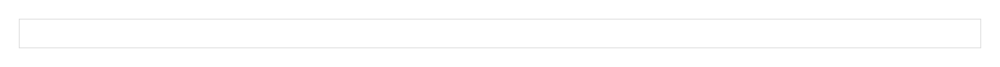
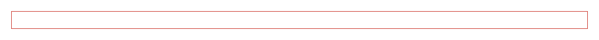

# Input


Source: `src/components/forms.tsx`

## Variants

### Default



```tsx
<Input />
```

### size: sm


```tsx
<Input size="sm" />
```

### size: md


```tsx
<Input size="md" />
```

### size: lg


```tsx
<Input size="lg" />
```

### invalid



```tsx
<Input invalid />
```

## Props

| Name | Type | Required | Default | Description |
|---|---|---|---|---|
| `size` | `Size \| undefined` |  | 'md' |  |
| `invalid` | `boolean \| undefined` |  |  |  |
| `leftAddon` | `React.ReactNode` |  |  |  |
| `rightAddon` | `React.ReactNode` |  |  |  |
| `describedBy` | `string \| undefined` |  |  |  |
