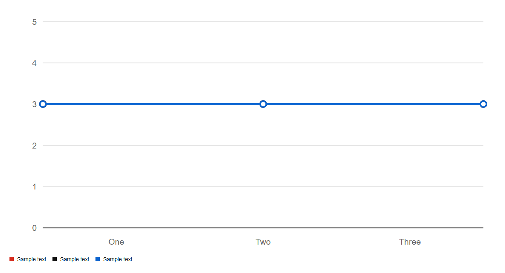
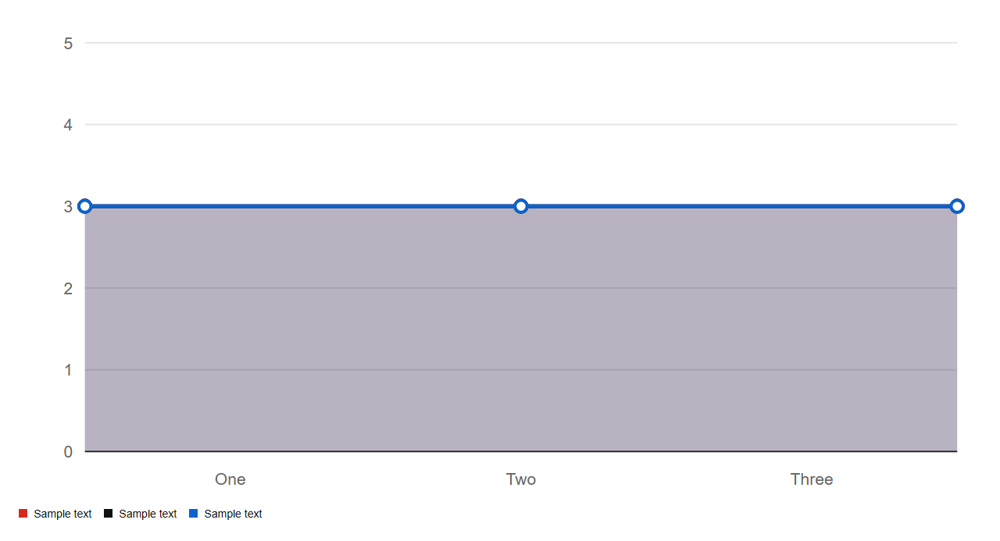

# LineChart


Source: `src/components/charts.tsx`

## Variants

### Default



```tsx
<LineChart series={[{"name":"Sample text","data":[3,3,3]},{"name":"Sample text","data":[3,3,3]},{"name":"Sample text","data":[3,3,3]}]} labels={["One","Two","Three"]} />
```

### area



```tsx
<LineChart series={[{"name":"Sample text","data":[3,3,3]},{"name":"Sample text","data":[3,3,3]},{"name":"Sample text","data":[3,3,3]}]} labels={["One","Two","Three"]} area />
```

## Props

| Name | Type | Required | Default | Description |
|---|---|---|---|---|
| `series` | `Series[]` | yes |  |  |
| `labels` | `string[]` | yes |  |  |
| `area` | `boolean \| undefined` |  |  |  |
| `title` | `string \| undefined` |  | 'Line chart' |  |
