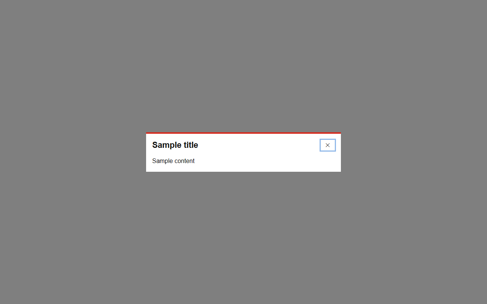

# Modal


Source: `src/components/containers.tsx`

## Variants

### Default


```tsx
<Modal isOpen={false} onClose={() => {}} title="Sample title">Sample content</Modal>
```

### isOpen



```tsx
<Modal isOpen onClose={() => {}} title="Sample title">Sample content</Modal>
```

## Props

| Name | Type | Required | Default | Description |
|---|---|---|---|---|
| `isOpen` | `boolean` | yes |  |  |
| `onClose` | `() => void` | yes |  |  |
| `title` | `string` | yes |  |  |
| `children` | `React.ReactNode` | yes |  |  |
| `footer` | `React.ReactNode` |  |  |  |
