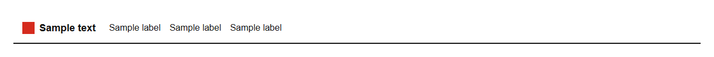

# Navbar


Source: `src/components/navigation.tsx`

## Variants

### Default



```tsx
<Navbar brand="Sample text" links={[{"label":"Sample label","href":"#"},{"label":"Sample label","href":"#"},{"label":"Sample label","href":"#"}]} />
```

## Props

| Name | Type | Required | Default | Description |
|---|---|---|---|---|
| `brand` | `string` | yes |  |  |
| `links` | `NavLink[]` | yes |  |  |
| `actions` | `React.ReactNode` |  |  |  |
| `mega` | `{ label: string; groups: MegaGroup[]; } \| undefined` |  |  | Optional megamenu rendered under the first link when hovered/clicked. |
