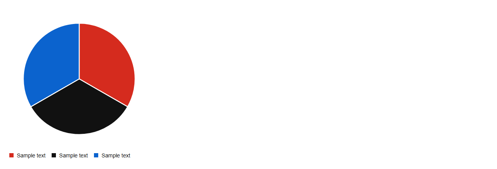
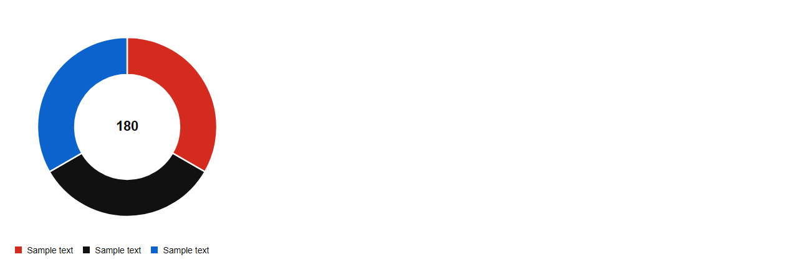

# PieChart


Source: `src/components/charts.tsx`

## Variants

### Default



```tsx
<PieChart data={[{"name":"Sample text","value":60},{"name":"Sample text","value":60},{"name":"Sample text","value":60}]} />
```

### donut



```tsx
<PieChart data={[{"name":"Sample text","value":60},{"name":"Sample text","value":60},{"name":"Sample text","value":60}]} donut />
```

## Props

| Name | Type | Required | Default | Description |
|---|---|---|---|---|
| `data` | `Slice[]` | yes |  |  |
| `donut` | `boolean \| undefined` |  |  |  |
| `title` | `string \| undefined` |  | 'Pie chart' |  |
| `centerLabel` | `string \| undefined` |  |  |  |
