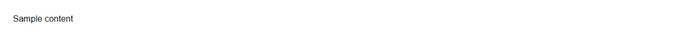

# RadioGroup


Source: `src/components/forms.tsx`

## Variants

### Default



```tsx
<RadioGroup name="Sample text">Sample content</RadioGroup>
```

### orientation: vertical


```tsx
<RadioGroup name="Sample text" orientation="vertical">Sample content</RadioGroup>
```

### orientation: horizontal


```tsx
<RadioGroup name="Sample text" orientation="horizontal">Sample content</RadioGroup>
```

## Props

| Name | Type | Required | Default | Description |
|---|---|---|---|---|
| `name` | `string \| undefined` |  |  |  |
| `value` | `string \| undefined` |  |  |  |
| `defaultValue` | `string \| undefined` |  |  |  |
| `onChange` | `((v: string) => void) \| undefined` |  |  |  |
| `orientation` | `"vertical" \| "horizontal" \| undefined` |  | 'vertical' |  |
| `legend` | `string \| undefined` |  |  |  |
| `children` | `React.ReactNode` | yes |  |  |
