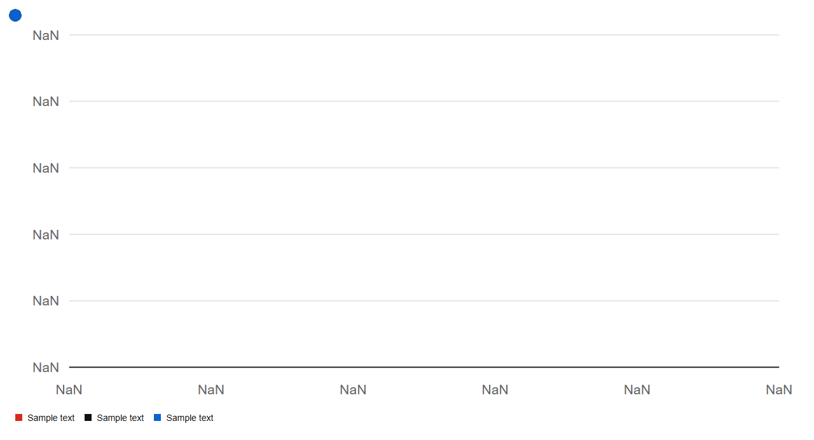

# ScatterChart


Source: `src/components/charts.tsx`

## Variants

### Default



```tsx
<ScatterChart series={[{"name":"Sample text","points":[{},{},{}]},{"name":"Sample text","points":[{},{},{}]},{"name":"Sample text","points":[{},{},{}]}]} />
```

## Props

| Name | Type | Required | Default | Description |
|---|---|---|---|---|
| `series` | `ScatterSeries[]` | yes |  |  |
| `title` | `string \| undefined` |  | 'Scatter plot' |  |
