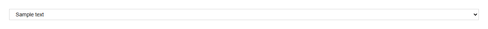
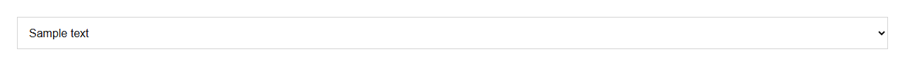
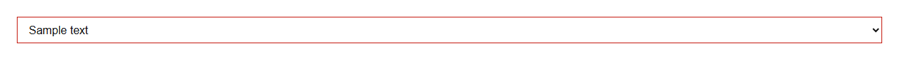

# Select


Source: `src/components/forms.tsx`

## Variants

### Default


```tsx
<Select placeholder="Sample text" options={[{"value":"Sample text","label":"Sample label"},{"value":"Sample text","label":"Sample label"},{"value":"Sample text","label":"Sample label"}]} />
```

### size: sm



```tsx
<Select placeholder="Sample text" options={[{"value":"Sample text","label":"Sample label"},{"value":"Sample text","label":"Sample label"},{"value":"Sample text","label":"Sample label"}]} size="sm" />
```

### size: md


```tsx
<Select placeholder="Sample text" options={[{"value":"Sample text","label":"Sample label"},{"value":"Sample text","label":"Sample label"},{"value":"Sample text","label":"Sample label"}]} size="md" />
```

### size: lg



```tsx
<Select placeholder="Sample text" options={[{"value":"Sample text","label":"Sample label"},{"value":"Sample text","label":"Sample label"},{"value":"Sample text","label":"Sample label"}]} size="lg" />
```

### invalid



```tsx
<Select placeholder="Sample text" options={[{"value":"Sample text","label":"Sample label"},{"value":"Sample text","label":"Sample label"},{"value":"Sample text","label":"Sample label"}]} invalid />
```

## Props

| Name | Type | Required | Default | Description |
|---|---|---|---|---|
| `size` | `Size \| undefined` |  | 'md' |  |
| `invalid` | `boolean \| undefined` |  |  |  |
| `placeholder` | `string \| undefined` |  |  |  |
| `options` | `{ value: string; label: string; }[]` | yes |  |  |
