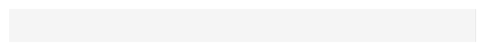

# Sidebar


Source: `src/components/navigation.tsx`

## Variants

### Default



```tsx
<Sidebar sections={[{"links":[{},{},{}]},{"links":[{},{},{}]},{"links":[{},{},{}]}]} />
```

## Props

| Name | Type | Required | Default | Description |
|---|---|---|---|---|
| `sections` | `{ title?: string; links: NavLink[]; }[]` | yes |  |  |
| `footer` | `React.ReactNode` |  |  |  |
