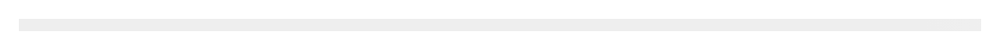

# Skeleton


Source: `src/components/feedback.tsx`

## Variants

### Default



```tsx
<Skeleton />
```

### circle


```tsx
<Skeleton circle />
```

## Props

| Name | Type | Required | Default | Description |
|---|---|---|---|---|
| `width` | `string \| number \| undefined` |  | '100%' |  |
| `height` | `string \| number \| undefined` |  | '1rem' |  |
| `circle` | `boolean \| undefined` |  |  |  |
| `lines` | `number \| undefined` |  | 1 |  |
