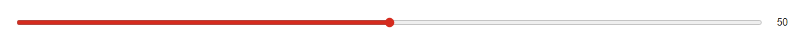

# Slider


Source: `src/components/forms.tsx`

## Variants

### Default



```tsx
<Slider label="Sample label" />
```

## Props

| Name | Type | Required | Default | Description |
|---|---|---|---|---|
| `min` | `number \| undefined` |  | 0 |  |
| `max` | `number \| undefined` |  | 100 |  |
| `step` | `number \| undefined` |  | 1 |  |
| `value` | `number \| undefined` |  |  |  |
| `defaultValue` | `number \| undefined` |  | 50 |  |
| `onChange` | `((v: number) => void) \| undefined` |  |  |  |
| `label` | `string \| undefined` |  |  |  |
| `format` | `((v: number) => string) \| undefined` |  |  |  |
