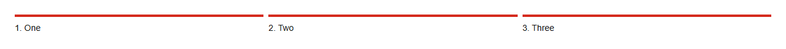

# Steps


Source: `src/components/feedback.tsx`

## Variants

### Default



```tsx
<Steps steps={["One","Two","Three"]} current={3} />
```

## Props

| Name | Type | Required | Default | Description |
|---|---|---|---|---|
| `steps` | `string[]` | yes |  |  |
| `current` | `number` | yes |  |  |
