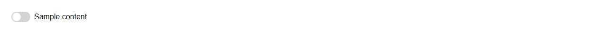
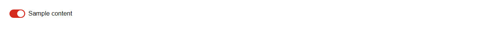

# Switch


Source: `src/components/forms.tsx`

## Variants

### Default



```tsx
<Switch label="Sample content" />
```

### checked



```tsx
<Switch label="Sample content" checked />
```

### defaultChecked


```tsx
<Switch label="Sample content" defaultChecked />
```

### disabled


```tsx
<Switch label="Sample content" disabled />
```

## Props

| Name | Type | Required | Default | Description |
|---|---|---|---|---|
| `checked` | `boolean \| undefined` |  |  |  |
| `defaultChecked` | `boolean \| undefined` |  | false |  |
| `onChange` | `((v: boolean) => void) \| undefined` |  |  |  |
| `label` | `React.ReactNode` |  |  |  |
| `disabled` | `boolean \| undefined` |  |  |  |
