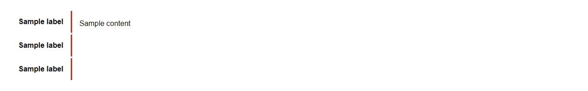
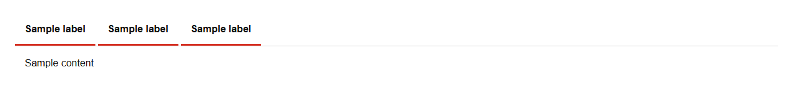

# Tabs


Source: `src/components/navigation.tsx`

## Variants

### Default


```tsx
<Tabs items={[{"id":"sample","label":"Sample label","content":"Sample content"},{"id":"sample","label":"Sample label","content":"Sample content"},{"id":"sample","label":"Sample label","content":"Sample content"}]} />
```

### orientation: vertical



```tsx
<Tabs items={[{"id":"sample","label":"Sample label","content":"Sample content"},{"id":"sample","label":"Sample label","content":"Sample content"},{"id":"sample","label":"Sample label","content":"Sample content"}]} orientation="vertical" />
```

### orientation: horizontal



```tsx
<Tabs items={[{"id":"sample","label":"Sample label","content":"Sample content"},{"id":"sample","label":"Sample label","content":"Sample content"},{"id":"sample","label":"Sample label","content":"Sample content"}]} orientation="horizontal" />
```

## Props

| Name | Type | Required | Default | Description |
|---|---|---|---|---|
| `items` | `TabItem[]` | yes |  |  |
| `value` | `string \| undefined` |  |  |  |
| `defaultValue` | `string \| undefined` |  |  |  |
| `onChange` | `((id: string) => void) \| undefined` |  |  |  |
| `orientation` | `"vertical" \| "horizontal" \| undefined` |  | 'horizontal' |  |
