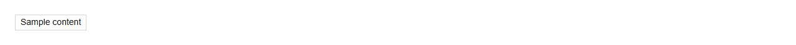
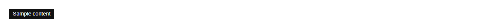

# Tag


Source: `src/components/feedback.tsx`

## Variants

### Default



```tsx
<Tag>Sample content</Tag>
```

### selected



```tsx
<Tag selected>Sample content</Tag>
```

## Props

| Name | Type | Required | Default | Description |
|---|---|---|---|---|
| `children` | `React.ReactNode` | yes |  |  |
| `selected` | `boolean \| undefined` |  |  |  |
| `onClick` | `(() => void) \| undefined` |  |  |  |
| `onRemove` | `(() => void) \| undefined` |  |  |  |
