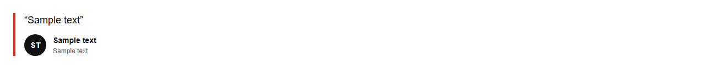

# Testimonial


Source: `src/components/sections.tsx`

## Variants

### Default



```tsx
<Testimonial quote="Sample text" author="Sample text" role="Sample text" />
```

## Props

| Name | Type | Required | Default | Description |
|---|---|---|---|---|
| `quote` | `string` | yes |  |  |
| `author` | `string` | yes |  |  |
| `role` | `string` | yes |  |  |
