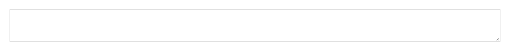
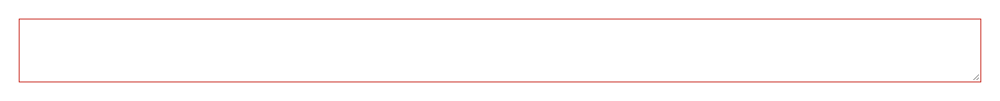

# Textarea


Source: `src/components/forms.tsx`

## Variants

### Default



```tsx
<Textarea />
```

### invalid



```tsx
<Textarea invalid />
```

### autoResize


```tsx
<Textarea autoResize />
```

## Props

| Name | Type | Required | Default | Description |
|---|---|---|---|---|
| `invalid` | `boolean \| undefined` |  |  |  |
| `autoResize` | `boolean \| undefined` |  |  |  |
| `describedBy` | `string \| undefined` |  |  |  |
