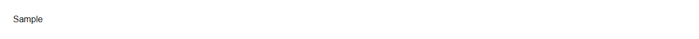

# Tooltip


Source: `src/components/containers.tsx`

## Variants

### Default



```tsx
<Tooltip content="Sample text">__el__</Tooltip>
```

## Props

| Name | Type | Required | Default | Description |
|---|---|---|---|---|
| `content` | `string` | yes |  |  |
| `children` | `React.ReactElement<any, string \| React.JSXElementConstructor<any>>` | yes |  |  |
| `delay` | `number \| undefined` |  | 200 |  |
