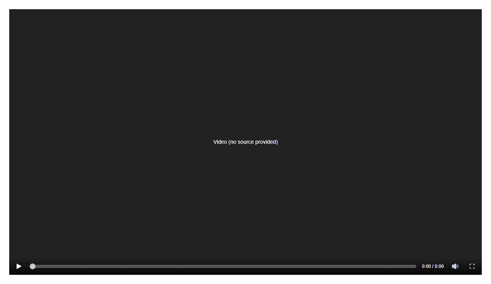

# VideoPlayer


Source: `src/components/sections.tsx`

## Variants

### Default



```tsx
<VideoPlayer />
```

## Props

| Name | Type | Required | Default | Description |
|---|---|---|---|---|
| `src` | `string \| undefined` |  |  |  |
| `poster` | `string \| undefined` |  |  |  |
| `title` | `string \| undefined` |  | 'Video' |  |
